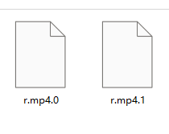
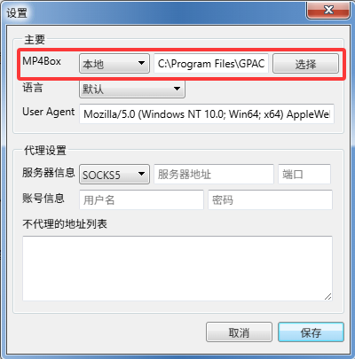

+++
title = '使用米当下载视频时一直不结束怎么办？'
date = 2026-10-11T17:35:20+08:00
draft = false
slug = 'medown-not-stop'
cover = "./medown.png"
keywords =['medown', '米当', '视频下载', '通用WEB视频下载软件', '不结束']
description = '通过手工合成的方式解决使用米当下载视频结束后还一直转圈的问题'
+++

**米当**的设计目标是通用的WEB视频下载软件，但在实际使用过程中，总会因为各种兼容性问题导致软件功能出现异常。

在用户的实际使用过程中，出现最多的就是视频明明已经下载完成了，但软件无法正常监测到下载完成，导致不能生成最终的视频文件。

用户反映，明明已经在目录中有下载完成的```.0```和```.1```文件，但是软件一直转圈，不能进入下一步。

<!--more-->

# 问题分析



在下载视频的时候，**米当**会分别将视频流和音频流分别存储到本地，其文件名正是```*.0```和```*.1```，然后当检查到视频和音频下载完成后，再调用```MP4box```将视频流和音频流合成为一个**MP4**文件，如果因为某种原因无法检测到视频和音频下载完成，就无法进入到下一步。

# 解决方案

首先，需要确认视频和音频已经全部下载完成，否则合成MP4文件可能会失败。


当这个蓝色圆圈全部完成（形成一个整圆）时，就表示已经下载完成了。这个时候，你可以直接退出软件，使用```MP4box```手动合成MP4文件。

> 关于```MP4box```的安装，请参考文章[https://www.lsz.sc.cn/posts/medown-mp4box/](https://www.lsz.sc.cn/posts/medown-mp4box/)。

使用以下命令将```*.0```和```*.1```合成MP4文件：

```bash
mp4box -add r.mp4.0 -add r.mp4.1 -new x.mp4
```

* -add 用于添加需要合成MP4文件的视频和音频文件。
* -new 合成的MP4文件存储名称。

上面的命令将```r.mp4.0```和```r.mp4.1```合成一个叫```x.mp4```的文件。

# 注意事项

若需要在磁盘上生成```*.0```和```*.1```的文件，需要在设置中将MP4box选项设置为本地。

